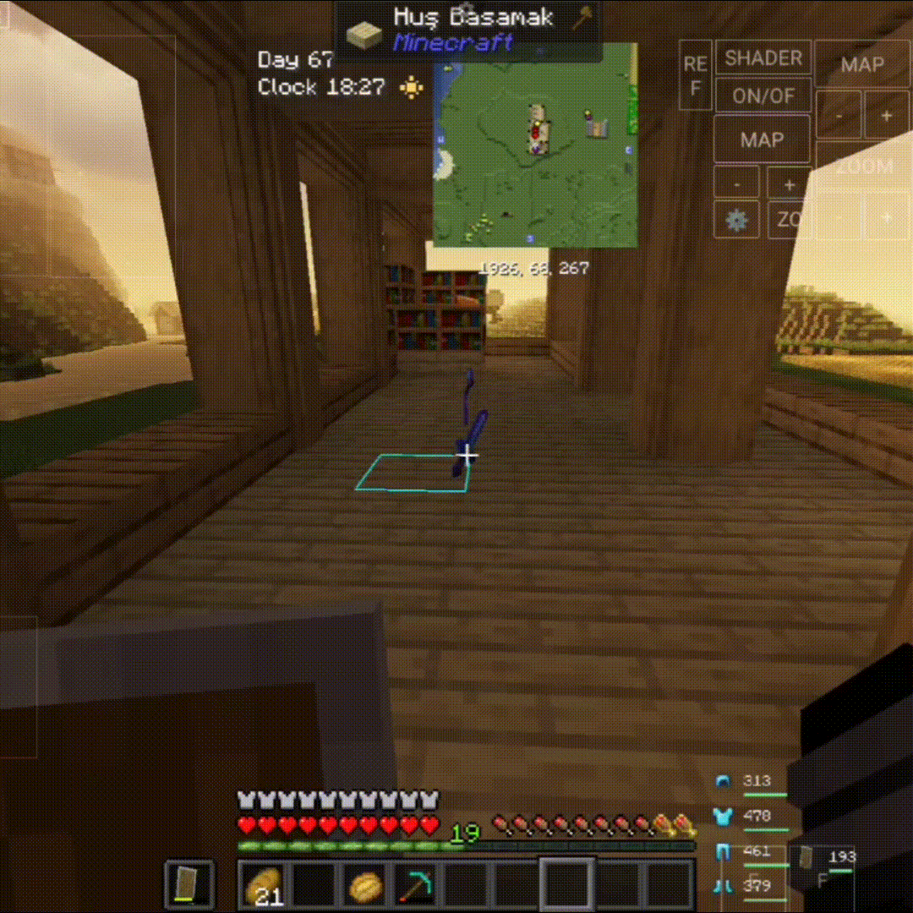

## Gameplay Preview

See animated item pickup and XP notifications in action.

--
# Inventory Pickup

> **Bêta publique 0.2.2 — Minecraft Java 1.21.10, Fabric.** Le JAR est disponible pour les essais. La compilation a réussi, mais les tests en jeu restent nécessaires.

Les notifications HUD animées apparaissent uniquement pour les **objets réellement ramassés au sol et les orbes d'expérience**. Si vous ramassez à nouveau le même objet pendant que sa notification est visible, le compteur **+N** augmente dans la carte existante et sa durée est **réinitialisée**. Les gains **+N XP** se regroupent de la même manière.

Déplacer des objets entre les emplacements, user un outil, fabriquer des objets ou transférer depuis un coffre ne génère plus de faux ramassages. La valeur XP est celle de l'orbe ramassée ; Raccommodage peut consommer une partie de cette expérience.

## Réglages

Appuyez sur **O** pour régler la durée, l'animation, l'opacité de fond avec un pas de 1 % et le nombre d'alertes. Vous pouvez déplacer la notification avec la souris et cliquer dessus pour modifier visuellement sa taille et son opacité. Les réglages sont enregistrés.

## Compatibilité et téléchargement

Minecraft **1.21.10**, **Fabric Loader**, **Fabric API**, **Java 21**. Téléchargez la **bêta 0.2.2** depuis **Downloads**. Retirez l'ancien JAR du dossier `mods` avant d'installer la nouvelle version. Les versions 0.2.0 et 0.1.0 restent disponibles. Tests en jeu encore nécessaires.

**Correctif 0.2.2 :** Le paquet Mixin qui bloquait le démarrage de Minecraft a été corrigé. Les fonctions de 0.2.1 restent disponibles.
